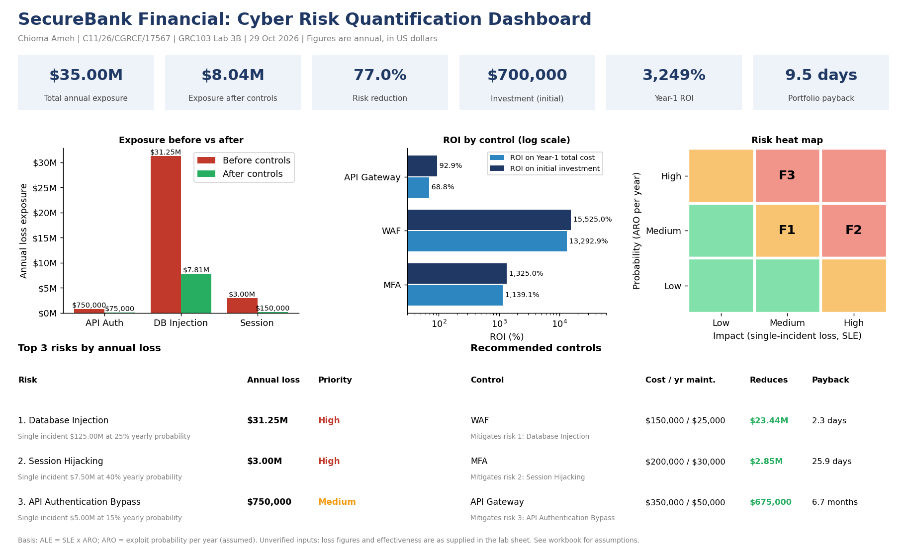

# Lab 3B: Advanced Cybersecurity Risk Quantification

**Student:** Chioma Ameh | **Registration number:** C11/26/CGRCE/17567 | **Course:** GRC103 | **Date:** 29 October 2026 (WAT)

An end-to-end quantitative risk assessment for SecureBank Financial's mobile banking platform: exposure (SLE, ARO, ALE), control cost-benefit (ROI and payback), prioritisation, a risk treatment roadmap, and a budget-constrained control selection. Every number comes from live formulas in the workbook.

## Headline results

| Measure | Result |
|---|---|
| Total annual exposure (ALE) | **$35,000,000** |
| Exposure after the three controls | **$8,037,500** |
| Annual risk reduction | **$26,962,500** (77.04%) |
| Net annual benefit after maintenance | $26,857,500 |
| Initial investment / annual maintenance | $700,000 / $105,000 |
| ROI on initial investment | 3,751.79% |
| ROI on Year-1 total cost | **3,249.38%** |
| Payback of the whole programme | **9.5 days** |

## Risks (Task 1 and Task 2)

| Rank | Vulnerability | SLE | ARO per year | ALE | Priority |
|---|---|---|---|---|---|
| 1 | Database Injection | $125,000,000 | 0.25 | $31,250,000 | High |
| 2 | Session Hijacking | $7,500,000 | 0.40 | $3,000,000 | High |
| 3 | API Authentication Bypass | $5,000,000 | 0.15 | $750,000 | Medium |

## Controls (Task 4)

| Control | Mitigates | Initial | Maintenance / yr | Effectiveness | Annual risk reduction | ROI (Year 1) | Payback |
|---|---|---|---|---|---|---|---|
| Web Application Firewall (WAF) | Database Injection | $150,000 | $25,000 | 75% | $23,437,500 | 13,292.86% | 2.3 days |
| MFA Enhancement | Session Hijacking | $200,000 | $30,000 | 95% | $2,850,000 | 1,139.13% | 25.9 days |
| Advanced API Security Gateway | API Authentication Bypass | $350,000 | $50,000 | 90% | $675,000 | 68.75% | 6.7 months |

## Budget-constrained selection (bonus)

| Budget limit | Best selection | Annual risk reduction | Share of maximum |
|---|---|---|---|
| $150,000 | WAF only | $23,437,500 | 86.9% |
| $200,000 | WAF only | $23,437,500 | 86.9% |
| $350,000 | WAF + MFA | $26,287,500 | 97.5% |
| $500,000 | WAF + MFA | $26,287,500 | 97.5% |
| $550,000 | WAF + MFA | $26,287,500 | 97.5% |
| $700,000 | All three controls | $26,962,500 | 100.0% |

**Recommendation:** treat all three risks, in the order WAF, MFA, API gateway. With a $500,000 cap, buy WAF + MFA and schedule the API gateway for Year 2.

## Repository map

| Path | Content |
|---|---|
| `docs/Lab3B_Risk_Quantification_Executive_Report.docx` | Full report: method, assumptions, calculations, figures, roadmap, limitations, AI declaration |
| `docs/Lab3B_Executive_Dashboard.pdf` and `.png` | One-page executive dashboard |
| `spreadsheet/Lab3B_Risk_Quantification_Workbook.xlsx` | All calculations with live formulas, heat map data and native Excel charts |
| `charts/` | The 10 required graphs as images (bar, pie, heat map, scatter, ROI bar, before/after, stacked, two line graphs, Gantt) |
| `presentation/Lab3B_Executive_Briefing.pptx` | Seven-slide executive briefing |

## How to check the numbers

Open the workbook and change any blue input on the `Inputs` sheet: everything recalculates. Spot checks: `Phase1_ALE!E6` = $31,250,000 (database injection ALE), `Phase2_Controls!O6` is about 2.3 days (WAF payback), `Phase2_Controls!O8` is about 9.5 days (programme payback).

## Assumptions (full list in the report, Section 2)

- ARO is the exploit probability treated as a yearly rate (the sheet does not say "per year").
- SLE uses the loss figures given in the sheet; no exposure factor is given, so none is applied.
- Each control mitigates the finding it is designed for, and its effectiveness applies to that finding only.
- Priority and heat map thresholds, the $500,000 budget case, and the timeline are my own choices and are labelled as assumptions.

## Limitations

Loss, probability, cost, and effectiveness figures are inputs from the lab sheet and were not independently validated. Results are single estimates, controls are treated as independent, and MFA's 95% effectiveness may be optimistic for stolen authenticated sessions. The report includes a sensitivity test.

## AI-assistance declaration

I used Claude (Anthropic) in this lab for explanation of the formulas and steps, checking/scrutinising my work against the lab sheet, building the workbook, charts, and dashboard, and drafting the wording of the report. I reviewed the results and spot-checked the key figures in the workbook myself. Full declaration: report Section 12.
